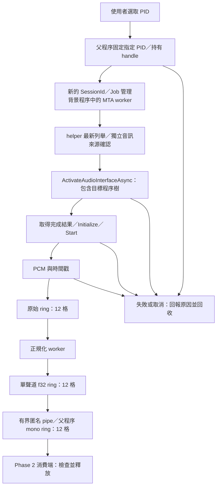

# Windows 10 19045 擷取設計與驗收計畫

日期：2026-10-05，更新：2026-10-08。範圍：Phase 2 — Process Capture。狀態：核心功能、300 次重啟、雙端點與 30 分鐘連續擷取通過；完整應用程式矩陣、實體拔除與服務中斷待人工。

## 基準與現況

使用者已確認原先提到的「19405」以目前本機 **19045** 為準。

| 項目 | 決定或已知結果 |
| --- | --- |
| 主要基準 | Windows 10 22H2、組建 19045、x86_64 |
| 本機環境 | Windows 10 Education，登錄資訊為 19045.6456；版本 API 顯示 10.0.19045.0 |
| 延伸平台 | Windows 11，待另外驗證；本機結果不外推至所有版本與裝置 |
| 已有實作 | 程序樹擷取封裝、兩個有界 ring、PCM 正規化、取消、SessionId、錯誤及資源管理 |
| 原版本阻擋 | 已移除 20348 硬性門檻；版本只供診斷 |
| 原生擷取狀態 | 本機真實 PCM、A／B 隔離、既有與新增子程序、根程序退出均通過 |
| 本次交付 | Rust 相容性修正、工作階段背景程序、有界 IPC、測試與驗收紀錄 |

[SPEC](../SPEC.md) 的 Windows 10／11、指定應用程式來源與不偷偷切換 System Mix 要求持續有效。Phase 0／1 成果沿用；先完成 Phase 2，STT、翻譯及視窗 UI 仍依原定後續 Phase 進行。

## 依據與修正

Microsoft 的 [activation 參數文件](https://learn.microsoft.com/en-us/windows/win32/api/audioclientactivationparams/ns-audioclientactivationparams-audioclient_activation_params) 列出最低支援組建 20348。先前直接把文件門檻當成執行時能力限制，造成我們自己的程式拒絕 19045；當時的硬體測試未走到原生 API，不能證明 Windows 不支援。

[OBS 官方指南](https://obsproject.com/kb/application-audio-capture-guide) 說明 Windows 10 2004 以上可使用應用程式音訊擷取。[OBS 28.0.0 原始碼](https://github.com/obsproject/obs-studio/blob/28.0.0/plugins/win-wasapi/plugin-main.cpp) 從組建 19041 啟用程序來源；[擷取程式](https://github.com/obsproject/obs-studio/blob/28.0.0/plugins/win-wasapi/win-wasapi.cpp) 使用相同的 Process Loopback API。

因此優先驗證既有原生方案。這是基於外部實作證據的設計判斷，後續已由本機實測驗證核心功能；外部相容性仍不能取代本專案逐項驗收。正式決策記錄於 [ADR 0003](adr/0003-runtime-capture-capability.md)。

## 啟動與資料流



此圖描述已實作流程。背景程序部署與 Timer 資源隔離理由見 [ADR 0004](adr/0004-session-owned-capture-process.md)。版本資訊僅供診斷，不能決定 `< 20348` 就禁止啟動。能力檢查直接使用所選來源的正式串流，避免重複啟動；列舉、無參數啟動及 `--help` 不得擷取音訊。

1. 父程序沿用 ProcessTarget::open 固定 PID；最新 Core Audio 列舉與獨立來源確認在 Session helper 完成，拒絕沒有有效音訊工作階段的來源。先持有 handle，避免 PID 重用；不把 HWND 視為擷取身分。
2. 只使用 `PROCESS_LOOPBACK_MODE_INCLUDE_TARGET_PROCESS_TREE`，範圍包含所選 PID 與子程序，跨播放裝置；不宣稱單一瀏覽器分頁隔離。
3. 啟動要求的立即結果與非同步完成結果分開記錄。取得 `IAudioClient` 後，在原擷取 worker 完成初始化、事件註冊及 Start。
4. `CaptureState::Running` 繼續表示 client 已啟動。另以接收計數／訊號狀態表達是否收到 PCM，不能把無聲誤判成 OS 不支援或來源已結束；也不把 Running 當成隔離證明。
5. 停止、切換來源、程序退出或 worker 失敗都沿用取消、join 與清空 ring。目標根程序退出時即停止，即使子程序仍存在；禁止自動換成別的 PID。

每次啟動重新確認來源與 API 結果，不建立持久化的「OS 支援／不支援」快取。受保護內容不能繞過；一般 endpoint loopback、麥克風、虛擬音效路由與注入均不納入自動替代流程。

## 失敗分類與格式策略

| 發生位置／現象 | 設計處理 |
| --- | --- |
| 版本診斷讀取失敗 | 記為未知，不因診斷失敗禁止嘗試正式擷取 |
| 無效來源、OpenProcess 失敗或程序退出 | 回報來源／權限／存活問題，保留有型別的錯誤，不推論整個 OS 不支援 |
| activation 立即失敗或完成結果失敗 | 保留是哪一階段及 HRESULT；證據明確時才標示功能不可用 |
| Initialize 格式／旗標被拒絕 | 記錄設定與 HRESULT，做最小相容性修正；不擴大到端點混音 |
| 啟動逾時或上一要求未完成 | 沿用 `ActivationTimeout`／`ActivationPending`，不無限重試 |
| Start 成功但沒有封包或只有靜音 | 顯示等待音訊／目前無訊號；保持可停止，不宣稱隔離通過 |
| 裝置或服務失效 | 停止並回報中斷，讓使用者重新選取；診斷保留實際失敗階段 |
| 未分類的 HRESULT | 顯示原生錯誤及階段，不強行歸類為系統不支援 |

先以既有 **PCM16、48 kHz、立體聲 → f32、48 kHz、單聲道** 路徑驗證。OBS 使用明確的浮點格式，足以說明格式與旗標也是需驗證的差異；不應把 Initialize 失敗直接歸咎於 Windows 版本。

若實測指出格式問題，再針對該 HRESULT 比對官方 API 與既有測試，決定是否加入 `WAVEFORMATEXTENSIBLE` 浮點格式。新增格式必須同步修改封包長度／對齊檢查、正規化及有界記憶體計算，禁止把浮點資料當 i16。第一輪不新增猜測性的多格式重試或額外後端，也不照抄其他軟體的長緩衝與無限等待。

## 保留的資源與隱私界線

| 邊界 | 延續的設計 |
| --- | --- |
| 執行緒 | helper 完成來源確認後釋放探索物件，再建立擷取／正規化 worker；含傳送與父程序接收，共四個角色 |
| 高頻佇列 | 每個 ring 12 格、每格 960 frames，滿載淘汰最舊資料 |
| 樣本記憶體 | 兩端通用 Session 配置合計最多 180 KiB 樣本空間，父程序 raw ring 未使用；metadata、stack、COM、pipe 與 Windows 緩衝另計 |
| 逾期 | 250 ms，從可用的原生 QPC 時戳到消費端檢查；時戳未知時明確標示 |
| 排序 | SessionId、sequence、frame position／QPC；晚到與舊 Session 結果不得被採用 |
| 啟動 | 同時最多一個待完成要求，10 秒啟動逾時，等待每 20 ms 檢查取消 |
| 原生回呼 | 取消後晚到只釋放結果；Windows 尚未釋放回呼時保持啟動要求上限 |
| 資源回收 | MTA／COM／handle／GetBuffer 與 ReleaseBuffer 維持 RAII 配對；關閉 pipe、join 父程序 worker，500 ms 未退出則終止自有 Job；背景程序退出回收原生資源 |
| 資料保存 | PCM 與訊號分析只在 RAM，測試亦不寫 WAV／PCM／音訊快取，不連線至雲端 |

20 ms 是取消檢查間隔，不是停止時間保證；Windows 同步呼叫不可強制中斷。250 ms 是逾期策略，不是已量測的擷取延遲。診斷只保留失敗階段、HRESULT、版本、格式與效能計數；不加入私人音訊、逐字稿、視窗標題或路徑。

## Phase 2 實作順序

P2-A／B／C 已完成；P2-D 的來源退出、300 次重啟、雙端點與 30 分鐘連續擷取已通過；實體裝置／服務中斷及完整應用程式矩陣仍待人工。下表保留原實作順序與完成條件，實測結果見 [Phase 2](phase-2.md)。

| 步驟 | 變更範圍 | 完成條件 |
| --- | --- | --- |
| P2-A 解除錯誤版本阻擋 | `src/win32/capture.rs` 的 `ensure_supported` 與兩處呼叫；`src/app/mod.rs`、`src/audio/capture.rs`、`src/ui/source_list.rs` 的訊息；`tests/startup.rs` 與硬體測試 ignore 說明 | 不再由 19045 組建直接拒絕；新測試驗證預先取消不啟動、API 失敗可辨識、沒有偷偷換來源；一般啟動／help 仍無音訊副作用 |
| P2-B 本機原生啟動 | 使用既有自建靜音 fixture，逐段查核 activation、Initialize、Start、PCM 與停止 | 在 19045.6456 實際呼叫 API，記錄結果；若失敗，先處理該階段再繼續，不能把失敗改為 skip |
| P2-C 非靜音與隔離 | 擴充 `src/win32/tests.rs` 的獨立程序 fixture，支援合成音、子程序及有界分析 | 目標音訊可辨識、非目標被排除、程序樹範圍及退出行為通過；測試不需私人內容 |
| P2-D 生命週期與應用程式 | 反覆停止／重啟、Session 切換、裝置／服務失效、來源相容性矩陣 | 記錄實測組建與各項結果，確認無舊資料或本程式遺留 worker，揭露未測項目 |

P2-A 不需新增通用後端系統或供應商抽象。延續目前 `Native { operation, code }` 的階段資訊；若為改善使用者訊息而分類錯誤，需保留原始診斷及測試分類規則，不能吞掉未知 HRESULT。

## 實機驗收方法

### 1. 可重現的非靜音與隔離

使用測試程式建立兩個互不從屬的程序 A、B，只選取 A。音源均為 RAM 產生的低振幅、不同頻率測試音；執行前提示會播放測試音，測試不得改動使用者的整體音量。先讓 A 建立可探索的 render Session，再沿正式來源確認流程啟動擷取。

| 測試時段 | 播放安排 | 驗收內容 |
| --- | --- | --- |
| A 單獨 | A 播放、B 靜音 | 收到新鮮非靜音 PCM，辨識到 A 的頻率；不能以有封包就算成功 |
| B 單獨 | A 保持 Session 但靜音、B 播放 | 擷取內沒有 B 訊號；允許靜音或沒有封包，不把沒有封包當失敗 |
| 同時發聲 | A、B 同時播放 | A 仍存在，B 不混入；總 RMS 不能取代頻率隔離檢查 |
| 交換目標 | 停止 A 的擷取，使用新 Session 擷取 B | B 可辨識、A 被排除；同時證明 B 確實有播放，避免負例假通過 |
| 目標子程序 | A 的子程序 C 發聲，B 為干擾源 | 擷取包含 C，仍排除 B；涵蓋擷取前已存在及啟動後新增的子程序 |
| 根程序退出 | A 結束但 C 暫時保持播放 | 本程式停止擷取及清空佇列，不因 C 尚在而繼續；測試結束亦回收 C |

使用串流相關性或 Goertzel 頻率分析，採固定大小時間窗，不累積整段音訊。頻率、振幅、起始穩定時間、每段截止時間與容許洩漏量須在測試中以具名常數說明並經正例校準；不以任意「confidence」取代可驗證的訊號量。遇到裝置靜音、音效處理或 fixture 未成功輸出，須記為測試條件不成立，不能報為隔離通過。

頻率分析只在測試消費端進行，不進入正式擷取回呼。所有子程序、render client、讀取執行緒與 RAM 緩衝在成功、失敗及逾時路徑都要回收；不得開啟使用者其他程式作為未經選取的測試目標。

### 2. 停止、失效與資源

- 原有靜音測試的三次重啟與來源退出先作基本驗證；再以至少 100 次停止／重啟及 30 分鐘連續執行作 Phase 2 初步檢查，較長壓力測試留在 Phase 11。
- 擷取前取消、等待 activation 時取消、Running 時取消及晚到回呼都要涵蓋；確認第一個失敗不被正常停止覆寫，舊 Session 資料不進入新 Session。
- 記錄停止耗時、首次 PCM、queue depth、逾期／過載淘汰、handle／thread 數與 private bytes。重啟測量報 P50／P95／最大值；記憶體與資源觀察暖機後是否持續成長，未測不得填數字。
- 對裝置切換／拔除及 Audio 服務中斷做人工測試，記錄實際行為；不中途自動停止使用者的系統服務。需要多個端點才能驗證跨端點時，缺少裝置就保留待驗。
- 失敗與停止均確認 PCM 佇列釋放、沒有音訊檔案或內容快取，也沒有遺留本程式的 worker。系統持有的晚到 activation 回呼需另行觀察，不能與已 join 的 worker 混為一談。

### 3. 相容性紀錄

| 環境／來源 | 目前狀態 | 應記錄證據 |
| --- | --- | --- |
| 本機 19045.6456，自建程序 A／B／C | 核心功能、雙端點及 30 分鐘通過；最終 300 次重啟 handle 163 → 163 | 原生啟動各階段、非靜音、隔離、程序樹、取消 |
| VLC、PotPlayer | 未驗證 | 程式版本、來源程序、播放／暫停／結束與隔離 |
| Chrome、Edge | 未驗證 | 音訊 helper／程序樹範圍，不把程序隔離寫成分頁隔離 |
| Spotify、Windows Media Player／Media Player | 未驗證 | 來源是否可擷取、無聲與受限內容結果 |
| 至少一款遊戲 | 未驗證 | 遊戲名稱／版本、程序範圍及實際輸出路徑 |
| 多個播放端點、切換／拔除、服務失效 | 未驗證 | 當次硬體／驅動、持續擷取或明確停止、資源回收 |
| Windows 11 | 未驗證 | 實際組建及修訂號，重跑同一組隔離與生命週期測試 |

紀錄只保存測試設定、錯誤與彙總結果，不保存使用者內容或 PCM。單一成功來源不能代表同列所有應用程式都相容；未安裝、未執行與失敗分別記錄。

## 驗收與交付界線

相容性程式變更完成後執行：

```powershell
cargo fmt --check
cargo clippy --locked --all-targets --all-features -- -D warnings
cargo test --locked
cargo build --locked
# 以下需要本機播放裝置，明確執行，不納入一般無硬體測試的通過數。
cargo test --locked native_session_appears_updates_and_disappears -- --ignored --nocapture
cargo test --locked native_process_capture_stops_and_detects_source_exit -- --ignored --nocapture
```

十項短時間實機／資源測試、30 分鐘與手動應用程式測試的命令及結果見 [Phase 2 驗收](phase-2.md) 與 [測試操作](phase-2-test-procedure.md)，一般測試另有 71 項通過、12 項預設略過。硬體驗證應逐一執行，避免多個 fixture 共用播放裝置及 activation 上限而干擾結果。

完成宣告分開列「程式檢查通過」、「本機擷取通過」、「隔離通過」與「逐項應用程式相容性」。目前四者不能相互替代。Phase 2 關閉前，須有 19045 的真實非靜音及隔離結果、取消／來源失效證據，並交代相容性矩陣的未測或受限項目；只移除版本檢查不算完成。

2026-10-07 已完成真實擷取、RAM 合成音隔離及資源測試；沒有修改整體音量、音訊路由或保存音訊。透過 winget 安裝官方 WinDbg 追查資源與記憶體生命週期，未保存記憶體傾印。2026-10-08 已補齊 30 分鐘與 300 次驗證；一般檢查與核心實測通過仍不代表整份應用程式矩陣或 Phase 11 更長期壓力測試完成；歷史失敗與本次結果分列於 [Phase 2](phase-2.md)。
